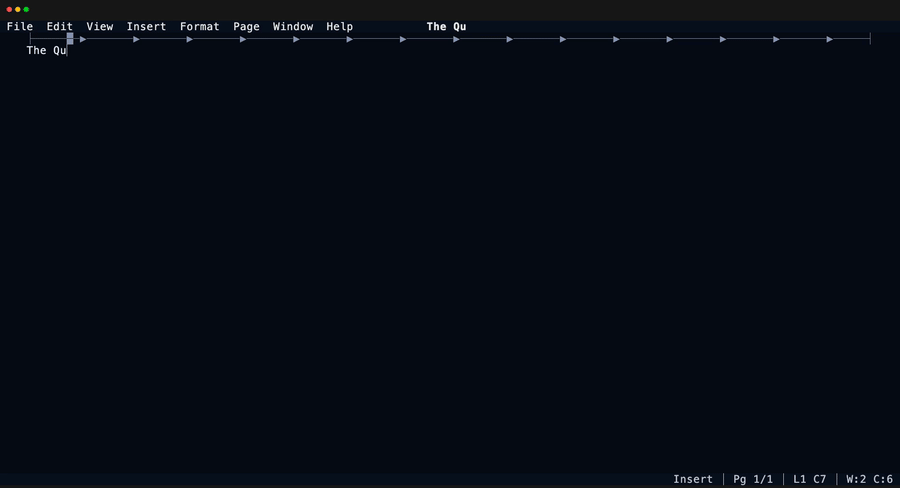

# Ordet

Ordet is a terminal word processor written in Rust. It runs completely offline on top of its own TUI framework (`ordet-tui-framework`) and saves documents as `.ord`, plain text, or Markdown.



It is built for writing long-form prose in the terminal: paragraph alignment, inline styles, a margin ruler, word counts and targets, a workspace browser, a side Notes panel, and up to four split windows. Autosave, crash recovery, backups, and revision history run in the background, and clipboard sync works natively on macOS, Linux (Wayland/X11/WSL), and Windows, as well as over SSH via OSC 52.

## Install

Ordet requires a stable [Rust toolchain](https://rustup.rs/) and a UTF-8 terminal. On Linux, `wl-copy`/`wl-paste` (Wayland) or `xclip`/`xsel` (X11) are used for the system clipboard when available.

```sh
cargo install ordet
```

Or build from source:

```sh
git clone https://github.com/LeonardoAmadeo/Ordet.git
cd Ordet
cargo install --path crates/ordet --locked
```

## Usage

```sh
ordet                        # Open a blank draft
ordet draft.ord notes.txt    # Open one or more files
```

Common flags: `--config <path>`, `--print-config`, `--reset-config`, `--latency-log`, `-h`/`--help`, `-V`/`--version`.

## Shortcuts

Press `F1` inside Ordet for the complete key reference, or `F10` to open the menu bar.

| Key | Action |
| :--- | :--- |
| `F1` / `F2` / `F10` | Help / Settings / Menu bar |
| `F6` | Cycle windows or pages |
| `Alt-N` / `Alt-W` | New split window / Close window |
| `Ctrl-S` / `Ctrl-Shift-S` | Save / Save As |
| `Ctrl-F` | Find (toggle regex `Alt-R`, whole word `Alt-W`, case `Alt-C`) |
| `Ctrl-Z` / `Ctrl-Shift-Z` | Undo / Redo |
| `Ctrl-X` / `Ctrl-C` / `Ctrl-V` | Cut / Copy / Paste |
| `Ctrl-K` / `Ctrl-O` | Block & file chords / Paragraph alignment chords |
| `Ctrl-Q` / `Esc` | Quit / Close panel or modal |

## Configuration

Settings, crash recovery (`recovery.json`), and revision history (`history.json`) are stored in a single directory and can be edited in-app via `F2`:

- macOS: `~/Library/Application Support/ordet-tui/settings.json`
- Linux: `$XDG_CONFIG_HOME/ordet-tui/settings.json` (or `~/.config/ordet-tui/settings.json`)
- Windows: `%APPDATA%\ordet-tui\settings.json`

## Project structure

The workspace has three crates: `crates/ordet` (the word processor), `crates/ordet-tui-framework` (the custom ANSI diff renderer, buffer, layout, keymap, focus, and task pool), and `crates/ordet-format` (`.ord` parsing, serialization, and atomic writes).

Ordet is developed on macOS and tested in CI on macOS, Linux (PTY), and Windows (ConPTY — Windows Terminal or WezTerm recommended).

## License

Dual-licensed under [Apache-2.0](LICENSE-APACHE) or [MIT](LICENSE-MIT).
